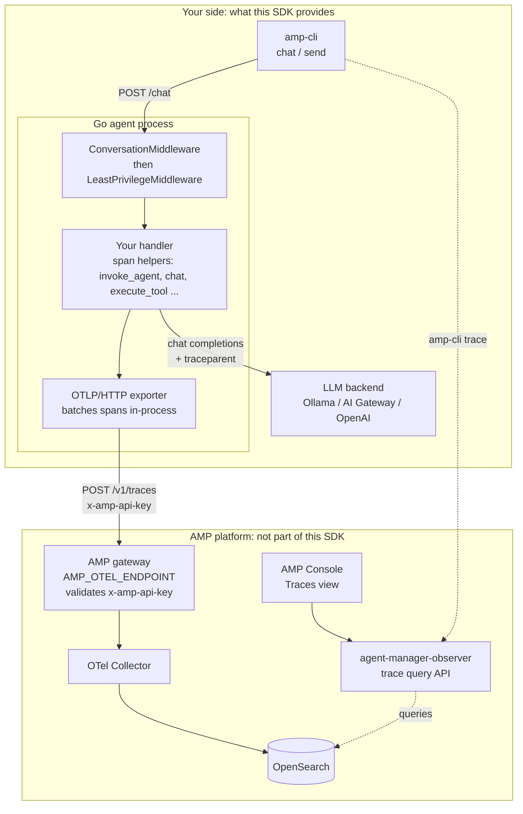
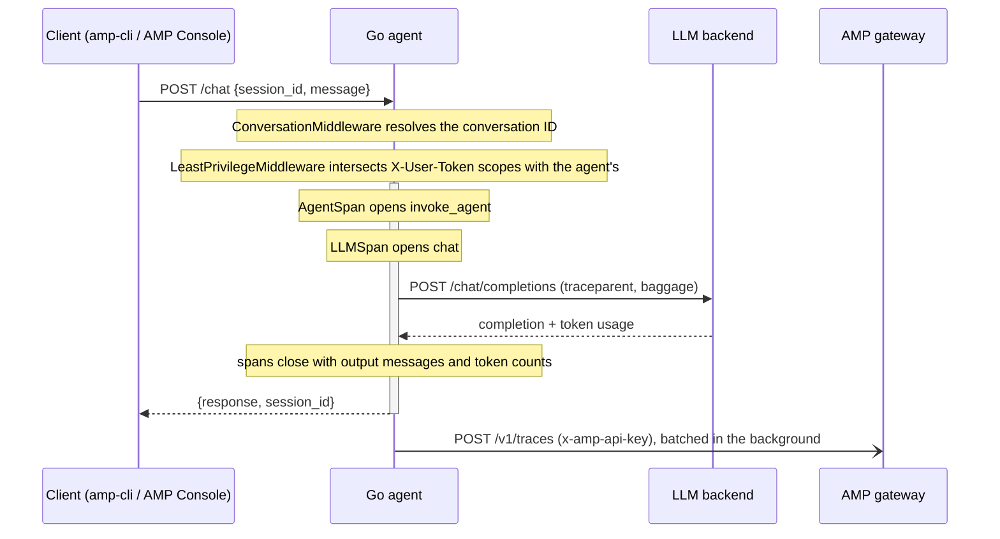
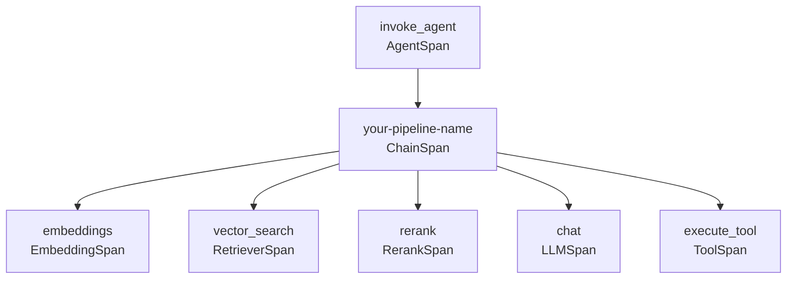

# amp-go — Go SDK for WSO2 Agent Manager

A first-class Go SDK for the [WSO2 Agent Manager](https://github.com/wso2/agent-manager) platform. It tracks **AMP v1.0.0** and is the Go counterpart of the Python `amp-instrumentation` package's manual path: `amp.InitOTel()` wires the OTLP exporter to AMP (the analog of `init_otel()`), and the span helpers emit spans that follow AMP's [manual instrumentation contract](https://wso2.github.io/agent-manager/docs/latest/guides/amp-instrumentation/#manual-instrumentation). Includes a CLI test harness and a reference multi-turn chatbot.

## Deliverables

| Package | Description |
|---|---|
| `amp/` | Core SDK: OTLP exporter setup, contract span helpers, conversation management, HTTP middleware, optional JWT lifecycle |
| `instrumentation/` | Zero-code auto-init via a blank import: sets up the exporter and client before `main()`. It does not create spans for you |
| `cmd/amp-cli/` | CLI test harness: `chat`, `send`, `trace`, `token`, `health` subcommands |
| `examples/chatbot/` | Reference HTTP chatbot with full middleware chain and LLM integration |
| `deploy/` | Kubernetes manifests for CLI Job and chatbot Deployment |

## Install

The module path is `github.com/wso2/amp-go`, but the code is hosted at `github.com/BechtelCanDoIt/amp-go-sdk`, so `go get github.com/wso2/amp-go` does not resolve. Clone this repository and point your module at the clone:

```bash
git clone git@github.com:BechtelCanDoIt/amp-go-sdk.git
cd your-agent
go mod edit -replace github.com/wso2/amp-go=../amp-go-sdk
go mod tidy
```

Then import `github.com/wso2/amp-go/amp`.

## Quickstart

### Prerequisites

- Go 1.22+
- An agent registered in the AMP Console, which gives you the OTLP endpoint and an agent API key
- An LLM backend for the reference chatbot (Ollama for local dev, WSO2 AI Gateway or a hosted LLM for prod)

### 1. Set environment variables

```bash
# Required — the only two variables tracing needs. On a platform-hosted agent
# with auto-instrumentation off, AMP's env-injection trait sets both for you.
export AMP_OTEL_ENDPOINT=<your-amp-otel-endpoint>   # e.g. http://<gateway-host>/otel; spans go to <endpoint>/v1/traces
export AMP_AGENT_API_KEY=<key-from-the-amp-console> # sent as x-amp-api-key

# LLM backend — defaults to Ollama
export LLM_API_URL=http://localhost:11434/v1
export LLM_MODEL=llama3.2

# Optional
export AMP_AGENT_NAME=chatbot       # default gen_ai.agent.name + service.name
export AMP_TRACE_CONTENT=true       # false redacts prompts/completions in spans
export AMP_DEBUG=0
```

The control-plane variables (`AMP_BASE_URL`, `AMP_ORG_NAME`, `AMP_PROJECT_NAME`) are optional and not needed for tracing — see [Agent JWT management](#agent-jwt-management).

### 2. Run the chatbot

```bash
# Local (requires Ollama running with llama3.2)
go run ./examples/chatbot/

# Test it
curl -X POST http://localhost:8080/chat \
  -H "Content-Type: application/json" \
  -d '{"session_id": "demo-1", "message": "Hello, what can you help me with?"}'
```

### 3. Use the CLI

```bash
# Build
go build -o bin/amp-cli ./cmd/amp-cli/

# Health check (reachability of the AMP OTLP endpoint, plus the AMP API if configured)
bin/amp-cli health

# Interactive chat
bin/amp-cli chat --agent-url http://localhost:8080

# Single message (CI-friendly)
bin/amp-cli send -m "Hello" --agent-url http://localhost:8080 --json

# View traces (needs AMP_TRACE_OBSERVER_URL, org/project/agent, AMP_ENVIRONMENT)
bin/amp-cli trace --n 10 --since 1h

# Fetch agent JWT (needs the control-plane variables)
bin/amp-cli token --json
```

### 4. Deploy to Kubernetes

The manifests reference `ghcr.io/wso2/amp-chatbot` and `ghcr.io/wso2/amp-cli`; these images are not published, so build them and push to a registry your cluster can pull from (or retag and edit the manifests). Set `AMP_OTEL_ENDPOINT` in both manifests to your AMP OTLP endpoint.

```bash
# Build images
docker build --target chatbot -t ghcr.io/wso2/amp-chatbot:latest .
docker build --target cli -t ghcr.io/wso2/amp-cli:latest .

# The manifests read the agent API key from this secret
kubectl create secret generic amp-agent-secret --from-literal=api-key=<key-from-the-amp-console>

# Deploy the chatbot, then run the CLI jobs (a health check and an interactive pod)
kubectl apply -f deploy/chatbot-deployment.yaml
kubectl apply -f deploy/amp-cli-job.yaml
kubectl logs job/amp-cli-health -f

# Interactive CLI inside the cluster
kubectl exec -it job/amp-cli-interactive -- amp-cli chat --agent-url http://chatbot:8080
```

## Architecture

The SDK runs entirely inside your agent process. It has no collector of its own: an in-process OpenTelemetry exporter batches spans and sends them to the AMP gateway. Everything past that gateway is the AMP platform, which this repository neither deploys nor configures.



### One chat request

What the reference chatbot does for a single `POST /chat`. Span export is asynchronous, so the response does not wait for AMP.



### Trace shape

Each helper produces one span; nesting follows the `context.Context` you pass down. The chatbot emits only `invoke_agent` → `chat`. A retrieval-augmented agent using every helper produces:



## SDK API

Three ways to initialize, from most to least managed. Pick one.

### Explicit init

```go
cfg := amp.FromEnv()
client, err := amp.Init(cfg)
if err != nil {
    log.Fatal(err)
}
defer client.Shutdown(context.Background()) // flushes pending spans
```

### Zero-code auto-init

```go
import _ "github.com/wso2/amp-go/instrumentation"

// The SDK initializes in init() before main().
// Use instrumentation.Client for the span helpers and middleware.
```

"Zero-code" covers setup only: unlike Python's `amp-instrument`, nothing is patched, so your code still creates the spans. The process panics at startup if `AMP_OTEL_ENDPOINT` or `AMP_AGENT_API_KEY` is missing, and a SIGTERM/SIGINT handler flushes spans and exits.

### Exporter only (`init_otel()` analog)

```go
shutdown, err := amp.InitOTel() // reads AMP_OTEL_ENDPOINT and AMP_AGENT_API_KEY
if err != nil {
    log.Fatal(err)
}
defer shutdown(context.Background())

tracer := otel.Tracer("my-agent") // emit your own contract-shaped spans
```

`InitOTel()` is idempotent and does no instrumentation; it only wires a `TracerProvider` + `BatchSpanProcessor` + OTLP/HTTP exporter to `<AMP_OTEL_ENDPOINT>/v1/traces`.

### Span instrumentation

One helper per span kind in the contract. Each runs your function inside the span and writes the response attributes from its result; a returned error marks the span failed (`Status=Error` + `error.type`).

```go
// Agent span — root span for one agent invocation
client.AgentSpan(ctx, amp.AgentRequest{
    Description:        "Answers questions about orders",
    Framework:          "my-framework",
    Model:              "gpt-4o",
    SystemInstructions: systemPrompt,
    ConversationID:     conversationID,
    Messages:           inputMessages,
}, func(ctx context.Context) (amp.AgentResult, error) {
    // LLM span — child of agent span
    result, err := client.LLMSpan(ctx, amp.LLMRequest{
        Model:       "gpt-4o",
        Provider:    "openai",
        Temperature: amp.Float64(0.7),
        Messages:    messages,
    }, func(ctx context.Context) (amp.LLMResult, error) {
        // Call your LLM here
        return amp.LLMResult{
            Content:          "response",
            PromptTokens:     42,
            CompletionTokens: 87,
            Model:            "gpt-4o-2024-05-13",
        }, nil
    })
    if err != nil {
        return amp.AgentResult{}, err
    }
    return amp.AgentResult{
        Messages:     []amp.Message{{Role: "assistant", Content: result.Content}},
        InputTokens:  result.PromptTokens,
        OutputTokens: result.CompletionTokens,
    }, nil
})

// Tool span
client.ToolSpan(ctx, amp.ToolRequest{
    Name:      "search_docs",
    CallID:    toolCall.ID,
    Arguments: input,
}, func(ctx context.Context) (any, error) {
    return searchDocs(input), nil
})
```

The remaining kinds follow the same shape: `ChainSpan` (workflow step), `EmbeddingSpan`, `RetrieverSpan`, and `RerankSpan`. `amp.MarkError(span, err)` flags any span as failed, and `amp.WithEvaluationBaggage(ctx, taskID, trialID)` joins a trace to an evaluation trial.

### HTTP middleware

`ConversationMiddleware` reads `X-Conversation-ID` (generating one if absent) and echoes it on the response. `LeastPrivilegeMiddleware` intersects the scopes in the caller's `X-User-Token` JWT with the agent's: no token means the agent's full scope, an empty intersection is a `403`. The token is decoded, not verified — it assumes a gateway in front of the agent has already validated the signature.

```go
mux := http.NewServeMux()

// Chain: ConversationMiddleware → LeastPrivilegeMiddleware → handler
chain := client.ConversationMiddleware()(
    client.LeastPrivilegeMiddleware([]string{"read:docs", "read:orders"})(
        myHandler,
    ),
)
mux.Handle("/chat", chain)
```

### Context values

```go
func myHandler(w http.ResponseWriter, r *http.Request) {
    convID := amp.ConversationIDFromContext(r.Context())
    scope  := amp.EffectiveScopeFromContext(r.Context())
    token  := amp.UserTokenFromContext(r.Context())
}
```

## OTEL Span Attribute Contract

The helpers emit AMP's v1.0.0 manual instrumentation contract: OpenTelemetry GenAI semantic conventions (`gen_ai.*`, plus `db.*` for retrievers), with the OpenLLMetry `traceloop.*` keys for what OTel has not standardized yet. Spans that follow it render with the full trace view in the AMP Console and feed evaluators. The authoritative reference is [the contract](https://wso2.github.io/agent-manager/docs/latest/guides/amp-instrumentation/#the-contract).

| Span kind | Helper | Span name | Attributes emitted |
|---|---|---|---|
| agent | `AgentSpan` | `invoke_agent` | `gen_ai.operation.name=invoke_agent`, `gen_ai.agent.name/description/tools`, `gen_ai.system`, `gen_ai.request.model`, `gen_ai.system_instructions`, `gen_ai.conversation.id`, `gen_ai.input/output.messages`, `gen_ai.usage.input_tokens/output_tokens` |
| llm | `LLMSpan` | `chat` | `gen_ai.operation.name=chat`, `gen_ai.system`, `gen_ai.request/response.model`, `gen_ai.request.temperature`, `gen_ai.input/output.messages`, `gen_ai.input.tools`, `gen_ai.usage.input_tokens/output_tokens` |
| tool | `ToolSpan` | `execute_tool` | `gen_ai.operation.name=execute_tool`, `gen_ai.tool.name/description/call.id`, `traceloop.entity.input/output` |
| chain | `ChainSpan` | caller's | `traceloop.span.kind=workflow`, `traceloop.entity.input/output` |
| embedding | `EmbeddingSpan` | `embeddings` | `gen_ai.operation.name=embeddings`, `gen_ai.system`, `gen_ai.request/response.model`, `gen_ai.prompt.{i}.content`, `gen_ai.usage.input_tokens` |
| retriever | `RetrieverSpan` | `vector_search` | `db.system.name`, `db.collection.name`, `db.vector.query.top_k` |
| rerank | `RerankSpan` | `rerank` | `traceloop.span.kind=rerank`, `gen_ai.operation.name=rerank`, `rerank.model`, `gen_ai.request.model` |
| any | `MarkError` | — | span `Status=Error` plus `error.type` |
| agent | `WithEvaluationBaggage` | — | W3C baggage `task_id` / `trial_id`, copied to `task.id` / `trial.id` on the agent span |

With `AMP_TRACE_CONTENT=false`, message text, tool arguments and results are replaced with `[redacted]`; span structure and metadata are still recorded.

## Configuration Reference

| Env Var | Description | Default |
|---|---|---|
| `AMP_OTEL_ENDPOINT` | AMP OTLP/HTTP endpoint; spans go to `<endpoint>/v1/traces` | **required** |
| `AMP_AGENT_API_KEY` | Agent API key generated in the AMP Console, sent as `x-amp-api-key` and validated by the AMP gateway | **required** |
| `AMP_AGENT_NAME` | Agent name: default `gen_ai.agent.name`, `service.name` resource attribute | `""` |
| `AMP_TRACE_CONTENT` | Capture prompts/completions (`false` redacts them) | `true` |
| `AMP_AGENT_VERSION` | `agent-manager/agent-version` resource attribute | `""` |
| `AMP_DEBUG` | Verbose logging | `0` |
| `AMP_BASE_URL` | AMP API base URL (control plane) | `""` |
| `AMP_ORG_NAME` | Organization name (control plane) | `""` |
| `AMP_PROJECT_NAME` | Project name (control plane) | `""` |
| `AMP_ENVIRONMENT` | Environment name for agent JWT requests and `amp-cli trace` | `""` |
| `AMP_TOKEN_REFRESH_BUFFER` | Refresh JWT this long before expiry (capped at half the token's lifetime) | `5m` |
| `AMP_TRACE_OBSERVER_URL` | agent-manager-observer base URL for `amp-cli trace` | `""` |
| `AMP_TRACE_OBSERVER_TOKEN` | Bearer token for `amp-cli trace` (same as `--token`) | `""` |
| `AMP_CONVERSATION_TTL` | How long an idle conversation's history is kept in memory | `30m` |
| `LLM_API_URL` | LLM backend URL | `http://localhost:11434/v1` |
| `LLM_API_KEY` | LLM API key | `""` |
| `LLM_MODEL` | Default model | `llama3.2` |

The reference chatbot and CLI also read `LISTEN_ADDR` (chatbot, default `:8080`), `AGENT_SCOPES` (chatbot, space-delimited, default `read:all`), `AGENT_URL` (CLI, default `http://localhost:8080`) and `X_USER_TOKEN` (CLI, sent as `X-User-Token`).

### Agent JWT management

Agent JWT management is enabled only when `AMP_BASE_URL`, `AMP_ORG_NAME`, `AMP_PROJECT_NAME` and `AMP_AGENT_NAME` are all set; `Init()` then acquires a token from `POST /api/v1/orgs/{org}/projects/{project}/agents/{agent}/token`, refreshes it in the background, and fails at startup if it cannot. Leave them unset for tracing only — `client.Token` is then `nil`.

> **Not verified against AMP v1.0.0.** The SDK authenticates this request with `AMP_AGENT_API_KEY` as the bearer token, but in v1.0.0 the token endpoint requires a caller with the `agent:token-manage` permission, and the API key generated in the Console is already a token issued by that same endpoint. Expect the request to be rejected unless your deployment allows it; tracing does not need this feature.

## Testing

```bash
# Everything, with the race detector (same as `make test`)
go test -race -v ./...

# Skip the auto-init test, which compiles and runs a sample agent as a subprocess
go test -short ./...
```

The tests need no AMP instance: they run against local stub OTLP, AMP API, observer and LLM servers, and the `amp` package decodes the exported OTLP payload to check spans as AMP would receive them.

## LLM Backend Configuration

### Ollama (local development)

```bash
# Install and start Ollama
ollama serve
ollama pull llama3.2

# SDK defaults point here
export LLM_API_URL=http://localhost:11434/v1
export LLM_MODEL=llama3.2
```

### WSO2 APIM / AI Gateway (dev/prod)

```bash
export LLM_API_URL=https://apim-gateway:8243/ai/v1
export LLM_API_KEY=<apim-consumer-key>
export LLM_MODEL=gpt-4o
```

### OpenAI (direct)

```bash
export LLM_API_URL=https://api.openai.com/v1
export LLM_API_KEY=sk-...
export LLM_MODEL=gpt-4o
```

## Project Structure

```
amp-go/
├── amp/                        Core SDK package
│   ├── config.go               Config struct + FromEnv()
│   ├── otel.go                 InitOTel() + OTLP exporter setup
│   ├── tracer.go               Contract span helpers (agent/llm/tool/chain/…)
│   ├── token.go                Optional JWT acquire, parse, refresh goroutine
│   ├── conversation.go         sync.Map + TTL eviction
│   ├── client.go               AMPClient wiring + health checks
│   ├── middleware.go           Least-privilege + conversation middleware
│   └── *_test.go               Unit tests
├── instrumentation/
│   ├── auto.go                 init() — zero-code auto-init
│   └── e2e/                    Subprocess test for auto-init + sample agent
├── cmd/amp-cli/
│   ├── main.go                 CLI entry point
│   └── cmd/                    Cobra subcommands
│       ├── root.go             Global flags + SDK init
│       ├── chat.go             Interactive REPL
│       ├── send.go             Single-shot message
│       ├── trace.go            Query agent-manager-observer
│       ├── token.go            Fetch agent JWT
│       ├── health.go           Connectivity check
│       └── cli_test.go         Command tests
├── examples/chatbot/
│   ├── main.go                 Reference HTTP chatbot
│   └── main_test.go            Handler tests
├── deploy/
│   ├── amp-cli-job.yaml        K8s Job for CLI
│   └── chatbot-deployment.yaml K8s Deployment + Service
├── Dockerfile                  Multi-stage (cli + chatbot targets)
├── Makefile                    Build, test, docker, run
├── go.mod                      Module definition
└── README.md                   This file
```
